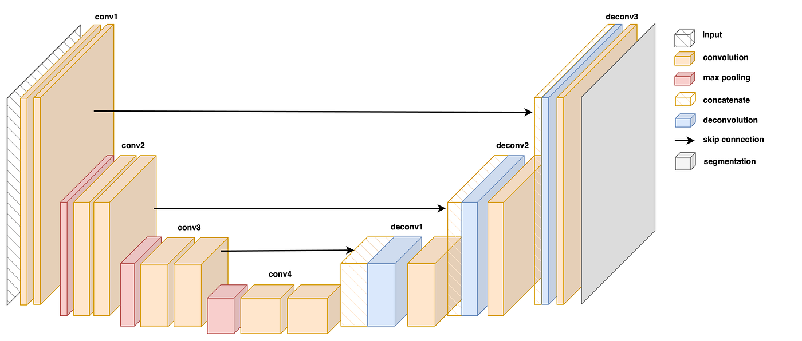

# UNet Semantic Segmentation for Geometric Shapes

This repository contains a TensorFlow/Keras implementation of the **U-Net architecture** designed for multi-class semantic segmentation on 2D synthetic geometric shapes. The project structure is organized to facilitate local prototyping as well as GPU-accelerated model training on platforms like Kaggle.

---

## 📌 Project Overview

* **Architecture:** U-Net (Encoder-Decoder with Skip Connections)
* **Framework:** TensorFlow / Keras
* **Task:** Multi-class Semantic Segmentation (4 classes: Background, Circles, Squares, Triangles)
* **Dataset:** Synthetic geometric shapes with corresponding segmentation masks

---
## Model architecture

## 📊 Model & Training Details

- **Input Shape:** `(256, 256, 3)` (or configured image resolution)
- **Output Shape:** `(256, 256, 4)` with `softmax` activation for 4 distinct segmentation classes.
- **Loss Function:** `sparse_categorical_crossentropy` / `categorical_crossentropy`
- **Metrics:** Accuracy & Mean Intersection over Union (mIoU)
